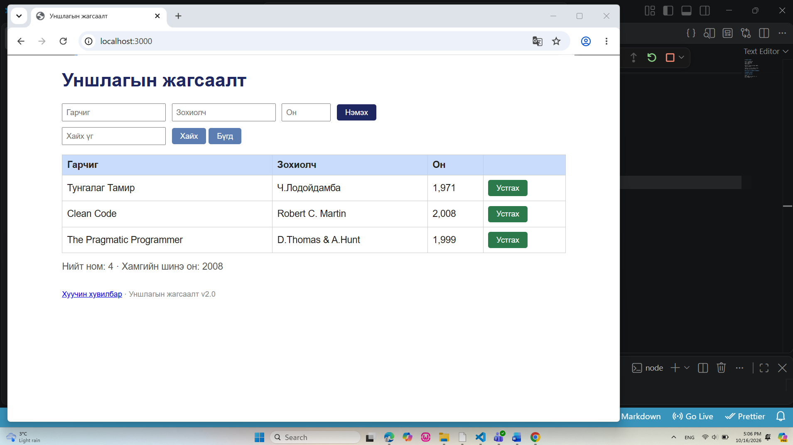

# BUG-01: Номын нийт тоолуур буруу байна

**Олдсон цаг:** 2026-10-16, 17:06
**Тестийн объект:** Уншлагын жагсаалт v2.0
**Орчин:** Windows, Google Chrome, Node.js
**Аялал:** Supermodel
**Ноцтой байдал (Severity):** Minor
**Төлөв (Status):** Open

## 1. Алдааны тайлбар

Аппликейшний хүснэгтэд 3 ном харагдаж
байгаа боловч нийт номын тоолуур 4 гэж
харуулж байна. Хүснэгтийн мэдээлэл болон
тоолуурын утга хоорондоо зөрүүтэй байна.

## 2. Дахин гаргах алхмууд

1. Node.js серверийг ажиллуулна.
2. http://localhost:3000 хаягаар орно.
3. Хүснэгтэд байгаа номын мөрүүдийг тоолно.
4. "Нийт ном" гэсэн тоолууртай харьцуулна.

## 3. Хүлээгдсэн үр дүн

Хүснэгтэд 3 ном байгаа тул
"Нийт ном: 3" гэж харагдах ёстой.

## 4. Бодит үр дүн

Хүснэгтэд 3 ном байгаа боловч
"Нийт ном: 4" гэж харагдсан.

## 5. Ноцтой байдлын үндэслэл

Minor — Хэрэглэгчид номын нийт тоог
буруу харуулж байгаа боловч ном нэмэх,
хайх, устгах үндсэн ажиллагааг
бүрэн зогсоохгүй.

## 6. Нотолгоо

