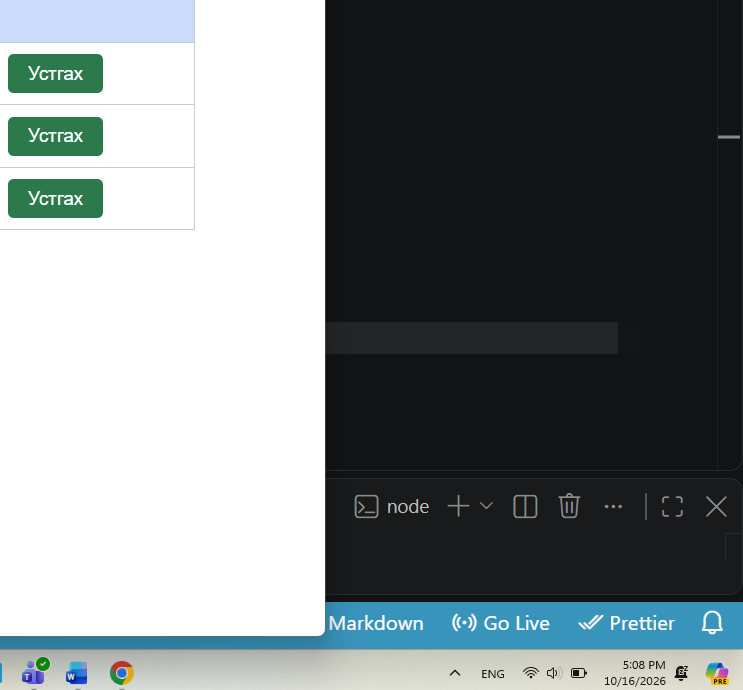

# BUG-02: Устгах товчны өнгө буруу байна

**Олдсон цаг:** 2026-10-16, 17:08
**Тестийн объект:** Уншлагын жагсаалт v2.0
**Орчин:** Windows, Google Chrome, Node.js
**Аялал:** Supermodel
**Ноцтой байдал (Severity):** Cosmetic
**Төлөв (Status):** Open

## 1. Алдааны тайлбар

Аппликейшний номын жагсаалтад байрлах
"Устгах" товч ногоон өнгөтэй харагдаж
байна. Интерфейсийн шаардлагын дагуу
устгах зэрэг эрсдэлтэй үйлдлийг улаан
өнгөөр ялган харуулах ёстой.

## 2. Дахин гаргах алхмууд

1. Node.js серверийг ажиллуулна.
2. http://localhost:3000 хаягаар орно.
3. Номын жагсаалт ачаалагдахыг хүлээнэ.
4. Ном бүрийн "Устгах" товчны өнгийг шалгана.

## 3. Хүлээгдсэн үр дүн

"Устгах" товчнууд интерфейсийн
шаардлагын дагуу улаан өнгөтэй
харагдах ёстой.

## 4. Бодит үр дүн

Ном бүрийн "Устгах" товч ногоон
өнгөтэй харагдаж байна.

## 5. Ноцтой байдлын үндэслэл

Cosmetic — Энэ нь интерфейсийн өнгөний
зөрүү бөгөөд устгах үйлдлийн үндсэн
ажиллагааг зогсоохгүй. Гэхдээ хэрэглэгч
устгах үйлдлийг бусад үйлдлээс
харагдах байдлаар ялгахад хүндрэлтэй.

## 6. Нотолгоо

