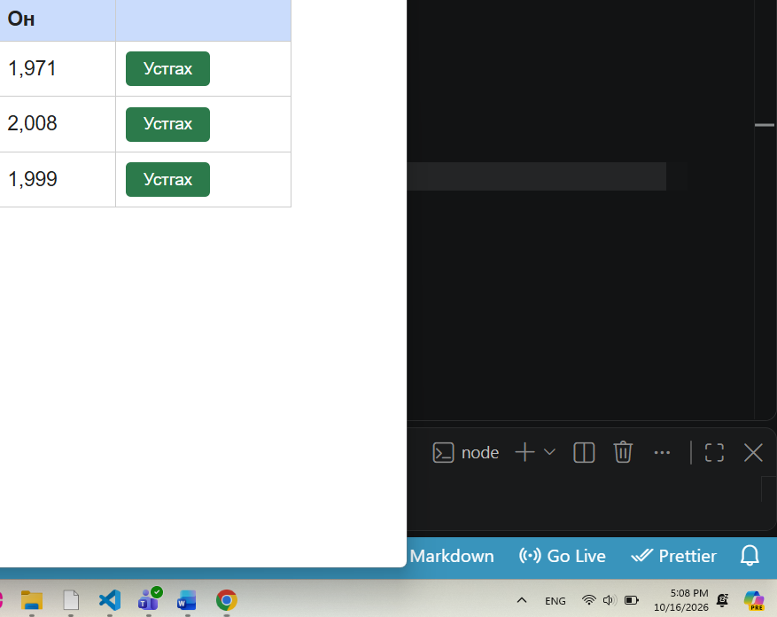

# BUG-03: Номын он буруу форматтай харагдаж байна

**Олдсон цаг:** 2026-10-16, 17:08
**Тестийн объект:** Уншлагын жагсаалт v2.0
**Орчин:** Windows, Google Chrome, Node.js
**Аялал:** Supermodel
**Ноцтой байдал (Severity):** Minor
**Төлөв (Status):** Open

## 1. Алдааны тайлбар

Аппликейшний номын жагсаалтын "Он"
баганад ном хэвлэгдсэн оныг мянгатын
тусгаарлагчтай харуулж байна.

Жишээлбэл, 1971 оныг "1,971",
2008 оныг "2,008" гэж харуулсан.

Номын он нь календарийн жилийн утга
учраас мянгатын тусгаарлагчгүйгээр
харагдах шаардлагатай.

## 2. Дахин гаргах алхмууд

1. Node.js серверийг ажиллуулна.
2. http://localhost:3000 хаягаар орно.
3. Номын жагсаалт ачаалагдахыг хүлээнэ.
4. Хүснэгтийн "Он" баганыг шалгана.
5. Харуулсан утгыг номын бодит онтой
   харьцуулна.

## 3. Хүлээгдсэн үр дүн

Ном хэвлэгдсэн он мянгатын
тусгаарлагчгүй харагдах ёстой.

Жишээ:
1971
2008
1999

## 4. Бодит үр дүн

Номын он мянгатын тусгаарлагчтай
харагдаж байна.

Жишээ:
1,971
2,008
1,999

## 5. Ноцтой байдлын үндэслэл

Minor — Номын хэвлэгдсэн оны утга
өөрчлөгдөөгүй боловч буруу форматтай
харагдаж байна.

Энэ нь мэдээллийн ойлгомжтой байдал,
интерфейсийн чанарт сөргөөр нөлөөлөх
боловч үндсэн үйлдлүүдийг зогсоохгүй.

## 6. Нотолгоо

