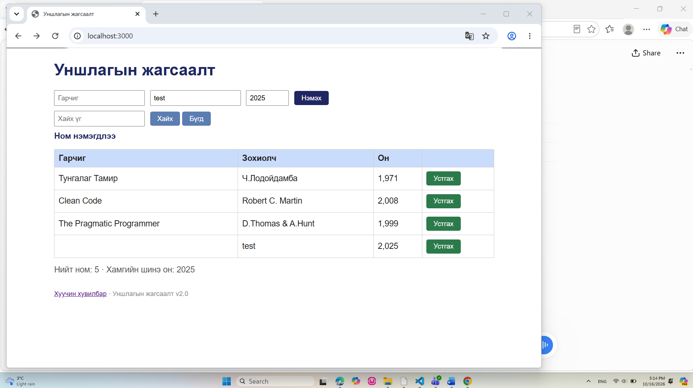

# BUG-04: Гарчиг хоосон байхад ном нэмэгдэж байна

**Олдсон цаг:** 2026-10-16, 17:14
**Тестийн объект:** Уншлагын жагсаалт v2.0
**Орчин:** Windows, Google Chrome, Node.js
**Аялал:** Couch Potato
**Ноцтой байдал (Severity):** Major
**Төлөв (Status):** Open

## 1. Алдааны тайлбар

Аппликейшний ном нэмэх хэсэгт "Гарчиг"
талбарыг хоосон үлдээсэн үед ном нэмэх
үйлдлийг зөвшөөрч байна.

Гарчиг нь номыг таних үндсэн мэдээлэл
боловч систем хоосон утгыг шалгахгүйгээр
номын жагсаалтад бүртгэж байна.

Үүний улмаас гарчиггүй, дутуу
мэдээлэлтэй номын бүртгэл үүсэж байна.

## 2. Дахин гаргах алхмууд

1. Node.js серверийг ажиллуулна.
2. http://localhost:3000 хаягаар орно.
3. "Гарчиг" талбарыг хоосон үлдээнэ.
4. "Зохиолч" талбарт test гэж бичнэ.
5. "Он" талбарт 2025 гэж оруулна.
6. "Нэмэх" товчийг дарна.
7. Хүснэгт болон мэдэгдлийн
   мессежийг шалгана.

## 3. Хүлээгдсэн үр дүн

"Гарчиг" талбар заавал бөглөгдөх
шаардлагатай тул хоосон утгатай
ном нэмэгдэхгүй байх ёстой.

Систем хэрэглэгчид гарчиг оруулахыг
шаардсан ойлгомжтой алдааны
мессеж харуулах ёстой.

## 4. Бодит үр дүн

"Ном нэмэгдлээ" гэсэн амжилттай
мессеж гарсан.

Хүснэгтэд гарчиггүй, зохиолч нь test,
он нь 2025 гэсэн шинэ ном нэмэгдсэн.

Өгөгдлийн баталгаажуулалт
хийгдээгүй байна.

## 5. Ноцтой байдлын үндэслэл

Major — Заавал бөглөх талбарын
шалгалт ажиллахгүй байгаа нь
өгөгдлийн бүрэн бүтэн байдалд
сөргөөр нөлөөлж байна.

Гарчиггүй ном бүртгэгдсэнээр
номыг таних, хайх болон удирдах
үйл ажиллагаанд хүндрэл үүсэж
болзошгүй.

## 6. Нотолгоо

