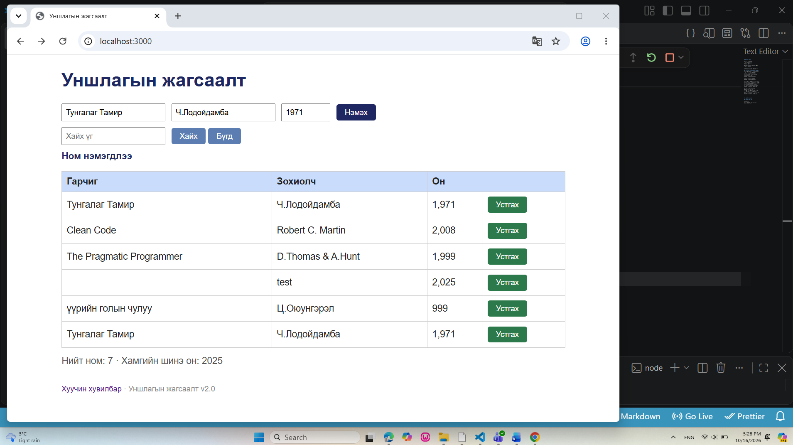

# BUG-06: Давхардсан ном нэмэхийг хориглохгүй байна

**Олдсон цаг:** 2026-10-16, 17:28
**Тестийн объект:** Уншлагын жагсаалт v2.0
**Орчин:** Windows, Google Chrome, Node.js
**Аялал:** Couch Potato
**Ноцтой байдал (Severity):** Major
**Төлөв (Status):** Open

## 1. Алдааны тайлбар

Аппликейшний ном нэмэх хэсэгт өмнө нь
бүртгэлтэй байгаа номын гарчиг болон
зохиолчийг давхардуулан оруулахад
систем тухайн номыг дахин бүртгэж байна.

Лабораторийн спецификацийн дагуу
ижил гарчиг, зохиолчтой номыг
давхардуулан нэмэх ёсгүй.

Гэвч "Тунгалаг Тамир" номыг ижил
мэдээллээр дахин нэмэхэд систем
давхардлыг шалгалгүй зөвшөөрсөн.

## 2. Дахин гаргах алхмууд

**Урьдчилсан нөхцөл:**
Node.js серверийг шинээр ажиллуулсан.
Жагсаалтад анхны 3 ном байгаа.

1. VS Code Terminal дээр
   `node app/app.js` командыг ажиллуулна.
2. Браузер дээр http://localhost:3000
   хаягаар орно.
3. Ном нэмэх хэсгийн "Гарчиг" талбарт
   Тунгалаг Тамир гэж бичнэ.
4. "Зохиолч" талбарт
   Ч.Лодойдамба гэж бичнэ.
5. "Он" талбарт 1971 гэж оруулна.
6. "Нэмэх" товчийг дарна.
7. "Тунгалаг Тамир" номын мөрүүд
   болон гарсан мессежийг шалгана.

## 3. Хүлээгдсэн үр дүн

Систем номын гарчиг болон зохиолчийг
өмнө бүртгэгдсэн номын мэдээлэлтэй
харьцуулан давхардлыг шалгах ёстой.

"Тунгалаг Тамир" ном анхны жагсаалтад
байгаа тул дахин нэмэгдэхгүй байх ёстой.

Хэрэглэгчид давхардсан ном бүртгэх
боломжгүйг тайлбарласан мессеж
харагдах шаардлагатай.

## 4. Бодит үр дүн

"Ном нэмэгдлээ" гэсэн амжилттай
мессеж гарсан.

Хүснэгтэд "Тунгалаг Тамир" нэртэй,
Ч.Лодойдамба зохиолчтой, 1971 онтой
ном хоёр удаа харагдсан.

Систем давхардсан номыг хориглоогүй.

## 5. Ноцтой байдлын үндэслэл

Major — Давхардсан ном бүртгэгдэх нь
өгөгдлийн бүрэн бүтэн байдал болон
үнэн зөв байдалд сөргөөр нөлөөлнө.

Номын тоолуур, хайлтын үр дүн болон
жагсаалтын удирдлагад төөрөгдөл
үүсгэх эрсдэлтэй.

## 6. Нотолгоо

