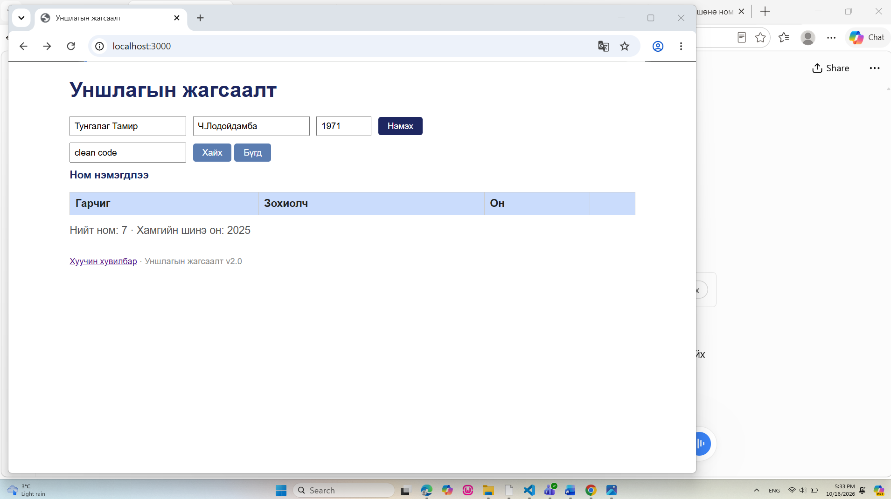

# BUG-07: Хайлт том, жижиг үсэг ялгаж байна

**Олдсон цаг:** 2026-10-16, 17:33
**Тестийн объект:** Уншлагын жагсаалт v2.0
**Орчин:** Windows, Google Chrome, Node.js
**Аялал:** Couch Potato
**Ноцтой байдал (Severity):** Major
**Төлөв (Status):** Open

## 1. Алдааны тайлбар

Аппликейшний номын хайлтын хэсэгт
номын гарчгийг жижиг үсгээр оруулахад
тухайн ном хайлтын үр дүнд
харагдахгүй байна.

Лабораторийн спецификацийн дагуу
хайлт нь том, жижиг үсэг ялгахгүй
(case-insensitive) ажиллах ёстой.

Гэвч "Clean Code" нэртэй номыг
"clean code" гэж хайхад үр дүн
хоосон гарсан.

## 2. Дахин гаргах алхмууд

**Урьдчилсан нөхцөл:**
Node.js серверийг шинээр ажиллуулсан.
Жагсаалтад анхны 3 ном байгаа.

1. VS Code-ийн Terminal дээр
   `node app/app.js` командыг ажиллуулна.
2. Браузер дээр http://localhost:3000
   хаягаар орно.
3. Жагсаалтад "Clean Code" ном
   байгаа эсэхийг шалгана.
4. "Хайх үг" талбарт `clean code`
   гэж жижиг үсгээр бичнэ.
5. "Хайх" товчийг дарна.
6. Хайлтын үр дүнг шалгана.

## 3. Хүлээгдсэн үр дүн

Хайлтын систем нь том, жижиг
үсгийг ялгахгүй ажиллах ёстой.

"clean code" гэсэн хайлтад
"Clean Code" нэртэй ном
үр дүнд харагдах шаардлагатай.

## 4. Бодит үр дүн

"clean code" гэж хайхад
хүснэгтэд ямар ч ном
харагдаагүй.

Жагсаалтад байгаа "Clean Code"
ном хайлтын үр дүнд ороогүй.

Энэ нь хайлтын ажиллагаа
том, жижиг үсэг ялгаж
байгааг харуулж байна.

## 5. Ноцтой байдлын үндэслэл

Major — Хайлт том, жижиг үсэг
ялгаж байгаа нь хэрэглэгчийн
шаардлагатай номоо олох
боломжийг хязгаарлаж байна.

Ном өгөгдлийн жагсаалтад
байгаа боловч хайлтын үр дүнд
харагдахгүй байгаа нь үндсэн
хайлтын ажиллагааны шаардлагыг
зөрчиж байна.

## 6. Нотолгоо

