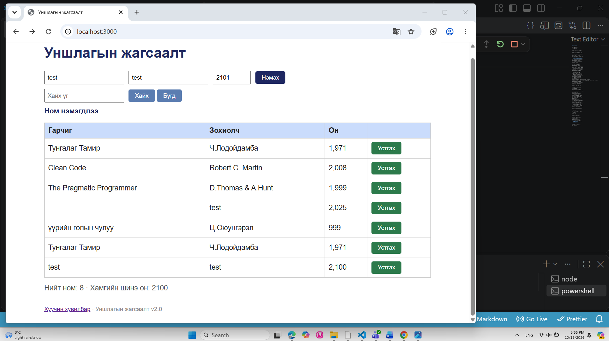

# BUG-09: Ном устгасны дараа буруу мессеж харагдаж байна

**Олдсон цаг:** 2026-10-16, 17:55
**Тестийн объект:** Уншлагын жагсаалт v2.0
**Орчин:** Windows, Google Chrome, Node.js
**Аялал:** Supermodel
**Ноцтой байдал (Severity):** Minor
**Төлөв (Status):** Open

## 1. Алдааны тайлбар

Уншлагын жагсаалт аппликейшнд ном
устгах үйлдэл амжилттай хийгдсэн ч
тухайн үйлдэлд тохирсон мессеж
харагдахгүй байна.

Туршилтын явцад 2101 онтой "test"
номыг устгахад хүснэгтээс тухайн
ном алга болсон боловч өмнөх
"Ном нэмэгдлээ" гэсэн мессеж
хэвээр харагдсан.

Лабораторийн спецификацийн дагуу
үйлдэл бүрийн дараах мессеж тухайн
үйлдэлтэйгээ тохирч байх ёстой.

## 2. Дахин гаргах алхмууд

**Урьдчилсан нөхцөл:**
Node.js серверийг шинээр ажиллуулсан.
Жагсаалтад анхны 3 ном байгаа.

1. VS Code Terminal дээр
   `node app/app.js` командыг ажиллуулна.
2. Браузер дээр http://localhost:3000
   хаягаар орно.
3. "Гарчиг" талбарт test гэж бичнэ.
4. "Зохиолч" талбарт test гэж бичнэ.
5. "Он" талбарт 2101 гэж оруулна.
6. "Нэмэх" товчийг дарна.
7. Шинээр нэмэгдсэн test номын
   "Устгах" товчийг дарна.
8. Номын жагсаалт болон дэлгэцийн
   мэдэгдлийн мессежийг шалгана.

## 3. Хүлээгдсэн үр дүн

Сонгосон ном хүснэгтээс
амжилттай устах ёстой.

Мөн хэрэглэгчид устгах үйлдэл
амжилттай хийгдсэнийг илэрхийлсэн
"Ном устгагдлаа" гэх мэт
тохирох мессеж харагдах ёстой.

## 4. Бодит үр дүн

2101 онтой test ном хүснэгтээс
амжилттай устсан.

Нийт номын тоо өөрчлөгдсөн
боловч дэлгэцэд
"Ном нэмэгдлээ" гэсэн мессеж
хэвээр харагдсан.

Ингэснээр хэрэглэгчид устгах
үйлдлийн үр дүнг буруу мэдээлж байна.

## 5. Ноцтой байдлын үндэслэл

Minor — Ном устгах үндсэн ажиллагаа
амжилттай хийгдэж байгаа боловч
хэрэглэгчид буруу мессеж харуулж байна.

Энэ нь хэрэглэгчийг төөрөгдүүлж,
үйлдэл амжилттай болсон эсэхэд
эргэлзээ үүсгэх боломжтой.

## 6. Нотолгоо

