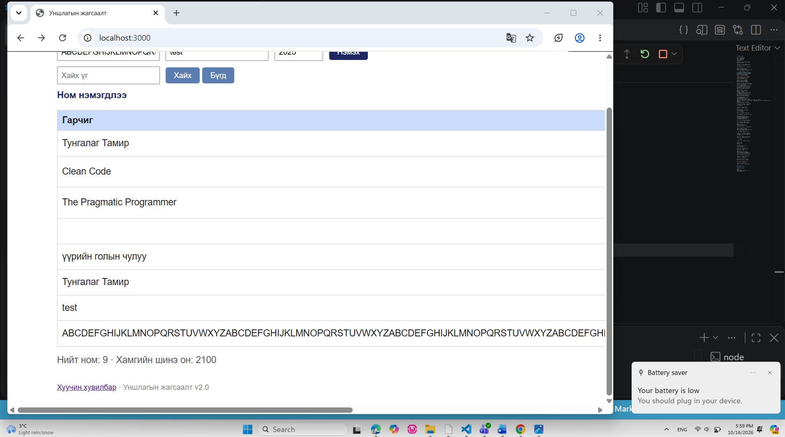

# BUG-10: Урт гарчиг оруулахад хүснэгтийн бүтэц алдагдаж байна

**Олдсон цаг:** 2026-10-16, 17:59
**Тестийн объект:** Уншлагын жагсаалт v2.0
**Орчин:** Windows, Google Chrome, Node.js
**Аялал:** Supermodel
**Ноцтой байдал (Severity):** Minor
**Төлөв (Status):** Open

## 1. Алдааны тайлбар

Уншлагын жагсаалт аппликейшнд
маш урт гарчигтай ном нэмэхэд
хүснэгтийн хэвийн байрлал алдагдаж байна.

Урт гарчиг хүснэгтийн баганын өргөнийг
хэт сунгаснаар зохиолч, он болон
устгах товчны баганууд дэлгэцийн
харагдах хэсгээс гарч байна.

Үүний улмаас хэвтээ гүйлгэх мөр
(horizontal scrollbar) үүсэж,
хүснэгтийн мэдээллийг нэг дор
харахад хүндрэлтэй болж байна.

## 2. Дахин гаргах алхмууд

**Урьдчилсан нөхцөл:**
Node.js серверийг шинээр ажиллуулсан.
Жагсаалтад анхны 3 ном байгаа.

1. VS Code Terminal дээр
   `node app/app.js` командыг ажиллуулна.
2. Браузер дээр http://localhost:3000
   хаягаар орно.
3. "Гарчиг" талбарт дараах текстийг
   5 удаа дараалан оруулна:

   ABCDEFGHIJKLMNOPQRSTUVWXYZ

4. "Зохиолч" талбарт test гэж бичнэ.
5. "Он" талбарт 2026 гэж оруулна.
6. "Нэмэх" товчийг дарна.
7. Хүснэгтийн өргөн, багануудын байрлал
   болон "Устгах" товч харагдаж
   байгаа эсэхийг шалгана.

## 3. Хүлээгдсэн үр дүн

Маш урт гарчигтай ном нэмсэн ч
хүснэгтийн бүтэц эвдрэхгүй байх ёстой.

Урт текстийг мөр шилжүүлэх эсвэл
зохистой байдлаар харуулж,
зохиолч, он болон устгах товчийг
ашиглах боломжтой байлгах ёстой.

## 4. Бодит үр дүн

Урт гарчиг хүснэгтийн гарчгийн
баганыг хэт өргөн болгосон.

Үүний улмаас зохиолч, он болон
устгах товчны баганууд дэлгэцийн
харагдах хэсгээс гарсан.

Хүснэгтийн доод хэсэгт хэвтээ
гүйлгэх мөр үүссэн.

## 5. Ноцтой байдлын үндэслэл

Minor — Аппликейшний үндсэн
ажиллагаа зогсоогүй боловч хүснэгтийн
харагдах байдал болон ашиглахад
тохиромжтой байдал алдагдсан.

Хэрэглэгч номын мэдээллийг бүрэн
харах, устгах товчид хүрэхийн тулд
нэмэлт гүйлгэх үйлдэл хийх
шаардлагатай болсон.

## 6. Нотолгоо

