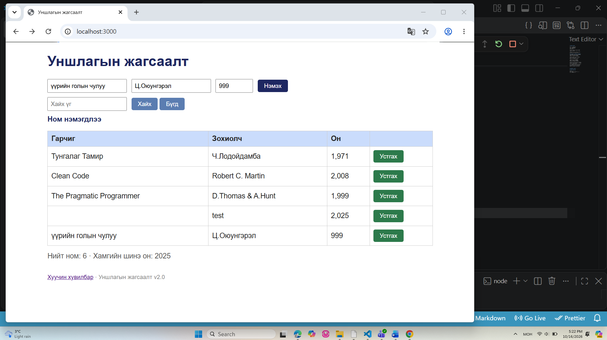
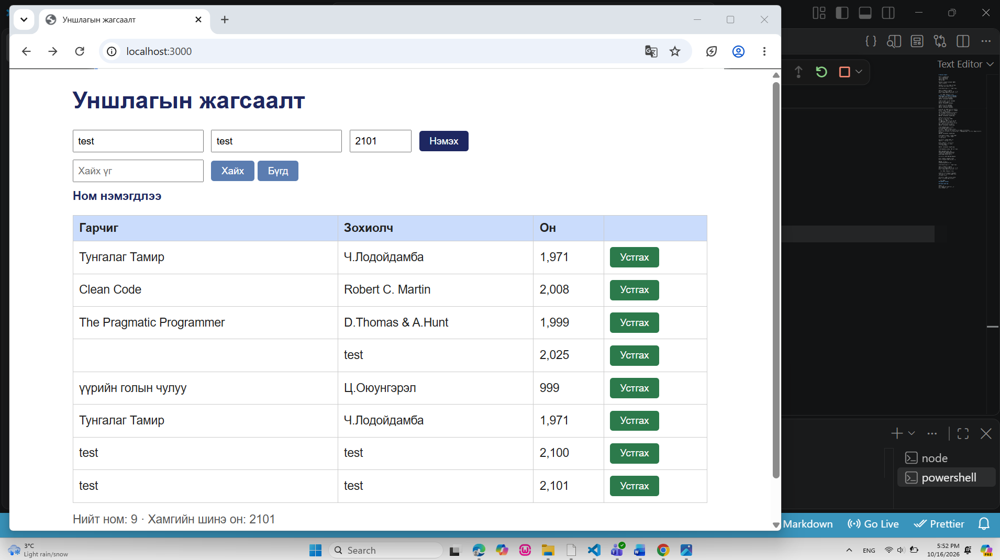

# Session Report

**Лаборатори №7:** Exploratory Testing — SBTM Session  
**Хичээл:** Программ хангамжийн чанарын баталгаа ба тест (F.CSA313)

**Тестер:** Г.Ганжаргал  
**Огноо:** 2026-10-16  
**Эхэлсэн цаг:** 17:01  
**Дууссан цаг:** 18:01  
**Нийт хугацаа:** 60 минут  
**Тестийн объект:** Уншлагын жагсаалт v2.0  
**Тестийн арга:** Exploratory Testing (SBTM)

**Mission:** Уншлагын жагсаалт веб аппликейшний үндсэн үйлдлүүд, өгөгдлийн баталгаажуулалт, хэрэглэгчийн интерфейс болон API-ийн ажиллагааг судалж, спецификацийн шаардлагаас зөрсөн согогуудыг илрүүлэх.

**Charter:** Ном нэмэх, хайх, устгах, өгөгдлийн зөв эсэхийг шалгах, хэрэглэгчийн интерфейсийн төлөв болон API-ийн хариуг Couch Potato, Saboteur, Supermodel аяллуудын тусламжтайгаар турших.

---

## 1. Тэмдэглэл (он цагийн дарааллаар)

### 17:06 — Номын тоолуурын шалгалт

Аппликейшнийг анхны төлөвт ажиллуулж, хүснэгтэд байгаа номын тоог шалгав.

- **Хүлээгдсэн үр дүн:** Хүснэгтэд байгаа 3 номтой нийцүүлэн «Нийт ном: 3» гэж харуулах.
- **Бодит үр дүн:** Хүснэгтэд 3 ном байгаа боловч «Нийт ном: 4» гэж харагдав.
- **Үр дүн:** FAIL
- **Согог:** BUG-01 — Номын тоолуур бодит тоотой зөрж байна.
- **Нотолгоо:** `screenshots/bug-01.png`

### 17:08 — Устгах товчны өнгөний шалгалт

Ном бүрийн «Устгах» товчны өнгийг интерфейсийн шаардлагатай харьцуулан шалгав.

- **Хүлээгдсэн үр дүн:** Аюултай үйлдэл болох «Устгах» товч улаан өнгөтэй байх.
- **Бодит үр дүн:** Устгах товчнууд ногоон өнгөтэй харагдав.
- **Үр дүн:** FAIL
- **Согог:** BUG-02 — Устгах товчны өнгө шаардлагад нийцэхгүй байна.
- **Нотолгоо:** `screenshots/bug-02.png`

### 17:08 — Номын оны харагдах хэлбэр

Хүснэгтийн «Он» баганад харуулж буй утгуудын форматыг шалгав.

- **Хүлээгдсэн үр дүн:** Номын он энгийн бүхэл тоогоор, жишээлбэл 1971 гэж харагдах.
- **Бодит үр дүн:** 1971 он нь `1,971` гэж мянгатын тусгаарлагчтай харагдав.
- **Үр дүн:** FAIL
- **Согог:** BUG-03 — Номын он буруу форматтай харагдаж байна.
- **Нотолгоо:** `screenshots/bug-03.png`

### 17:14 — Заавал бөглөх талбарын шалгалт

Ном нэмэх хэсгийн «Гарчиг» талбарыг хоосон үлдээж, бусад талбарт дараах өгөгдлийг оруулав.

- Гарчиг: Хоосон
- Зохиолч: `test`
- Он: `2025`

«Нэмэх» товчийг дарав.

- **Хүлээгдсэн үр дүн:** Заавал бөглөх талбар дутуу тул ном нэмэгдэхгүй, алдааны тайлбар харагдах.
- **Бодит үр дүн:** «Ном нэмэгдлээ» гэсэн мессеж гарч, гарчиггүй ном хүснэгтэд нэмэгдэв.
- **Үр дүн:** FAIL
- **Согог:** BUG-04 — Хоосон гарчигтай ном нэмэхийг зөвшөөрч байна.
- **Нотолгоо:** `screenshots/bug-04.png`

### 17:22 — Номын оны доод хязгаарын шалгалт

Зөвшөөрөгдөх оны доод хязгаараас бага утгаар ном нэмэхийг туршив.

- Гарчиг: Үүрийн голын чулуу
- Зохиолч: Ц.Оюунгэрэл
- Он: `999`

- **Хүлээгдсэн үр дүн:** Он нь 1000–2100 хооронд байх шаардлагатай тул ном нэмэгдэхгүй байх.
- **Бодит үр дүн:** «Ном нэмэгдлээ» гэсэн мессеж гарч, 999 онтой ном хүснэгтэд нэмэгдэв.
- **Үр дүн:** FAIL
- **Согог:** BUG-05 — Номын оны зөвшөөрөгдөх хязгаарыг шалгахгүй байна.
## Нотолгоо

**Доод хязгаар — 999 он:**

**Дээд хязгаар — 2101 он:**

### 17:28 — Давхардсан ном нэмэх шалгалт

Хүснэгтэд өмнө нь байсан «Тунгалаг Тамир» номыг ижил мэдээллээр дахин нэмэхийг туршив.

- Гарчиг: Тунгалаг Тамир
- Зохиолч: Ч.Лодойдамба
- Он: `1971`

- **Хүлээгдсэн үр дүн:** Ижил гарчиг, зохиолчтой ном давхар нэмэгдэхгүй байх.
- **Бодит үр дүн:** «Ном нэмэгдлээ» гэсэн мессеж гарч, «Тунгалаг Тамир» ном хүснэгтэд хоёр удаа харагдав.
- **Үр дүн:** FAIL
- **Согог:** BUG-06 — Давхардсан ном нэмэхийг хориглохгүй байна.
- **Нотолгоо:** `screenshots/bug-06.png`

### 17:33 — Том, жижиг үсэг ялгахгүй хайлтын шалгалт

Хайлтын талбарт `clean code` гэж жижиг үсгээр бичиж, «Хайх» товчийг дарав.

- **Хүлээгдсэн үр дүн:** Жагсаалтад байгаа «Clean Code» ном хайлтын үр дүнд харагдах.
- **Бодит үр дүн:** Хайлтын үр дүн хоосон харагдав.
- **Үр дүн:** FAIL
- **Согог:** BUG-07 — Хайлт том, жижиг үсэг ялгаж байна.
- **Нотолгоо:** `screenshots/bug-07.png`

### 17:40 — API-ийн буруу JSON өгөгдлийн шалгалт

Saboteur аяллын хүрээнд `POST /api/books` endpoint руу `Content-Type: application/json` толгойтой, `invalid-json` гэсэн буруу JSON өгөгдөл илгээв.

HTTP хүсэлтийг Windows PowerShell орчинд `curl.exe` ашиглан гүйцэтгэв.

- **Хүлээгдсэн үр дүн:** Сервер буруу JSON өгөгдлийг хүлээн авахаас татгалзаж, `HTTP 400 Bad Request` статус буцаах.
- **Бодит үр дүн:** Сервер `HTTP/1.1 200 OK` статус болон `{"result":"OK"}` хариу буцаав.
- **Үр дүн:** FAIL
- **Согог:** BUG-08 — API буруу JSON өгөгдөлд амжилттай статус буцааж байна.
- **Нотолгоо:** `evidence/bug-08-curl.txt`

### 17:47 — Зохиолчийн нэрээр хайх шалгалт

Хайлтын талбарт `Robert C. Martin` гэж оруулан хайлт хийв.

- **Хүлээгдсэн үр дүн:** Тухайн зохиолчийн «Clean Code» ном үр дүнд харагдах.
- **Бодит үр дүн:** «Clean Code» ном зөв гарч ирэв.
- **Үр дүн:** PASS
- **Дүгнэлт:** Зохиолчийн нэрээр хайх үйлдэл туршсан нөхцөлд шаардлагын дагуу ажиллав.

### 17:49 — Номын оны дээд хязгаарын зөв утгын шалгалт

Дээд хязгаар болох 2100 онтой ном нэмэхийг туршив.

- Гарчиг: `test`
- Зохиолч: `test`
- Он: `2100`

- **Хүлээгдсэн үр дүн:** 2100 он нь зөвшөөрөгдөх хүрээнд багтах тул ном амжилттай нэмэгдэх.
- **Бодит үр дүн:** Ном хүснэгтэд амжилттай нэмэгдэв.
- **Үр дүн:** PASS

### 17:52 — Номын оны дээд хязгаарын буруу утгын шалгалт

Зөвшөөрөгдөх дээд хязгаараас их утгаар ном нэмэхийг туршив.

- Гарчиг: `test`
- Зохиолч: `test`
- Он: `2101`

- **Хүлээгдсэн үр дүн:** 2101 он зөвшөөрөгдөхгүй тул ном нэмэгдэхгүй байх.
- **Бодит үр дүн:** «Ном нэмэгдлээ» гэсэн мессеж гарч, 2101 онтой ном хүснэгтэд нэмэгдэв.
- **Үр дүн:** FAIL
- **Согог:** BUG-05 — Оны хязгаарыг шалгахгүй байгаа согогийн нэмэлт баталгаажуулалт.
- **Нотолгоо:** `screenshots/bug-05-2101.png`

### 17:55 — Ном устгах үйлдэл болон мессежийн шалгалт

2101 онтой `test` номын «Устгах» товчийг дарав.

- **Хүлээгдсэн үр дүн:** Сонгосон ном устаж, тоолуур шинэчлэгдэх бөгөөд үйлдэлд тохирсон мессеж харагдах.
- **Бодит үр дүн:** Ном хүснэгтээс устаж, нийт номын тоо 9-өөс 8 болж өөрчлөгдөв. Гэвч «Ном нэмэгдлээ» гэсэн өмнөх мессеж хэвээр харагдав.
- **Үр дүн:** FAIL — үйлдлийн мессежийн хувьд.
- **Согог:** BUG-09 — Ном устгасны дараа мессеж шинэчлэгдэхгүй байна.
- **Нотолгоо:** `screenshots/bug-09.png`

### 17:59 — Урт гарчиг оруулах үеийн интерфейсийн шалгалт

Supermodel аяллын хүрээнд маш урт гарчигтай ном нэмэхийг туршив.

- Гарчиг: `ABCDEFGHIJKLMNOPQRSTUVWXYZ` текстийг 5 удаа давтсан.
- Зохиолч: `test`
- Он: `2026`

- **Хүлээгдсэн үр дүн:** Урт гарчигтай үед хүснэгтийн бүтэц хэвийн хадгалагдаж, бусад багана болон үйлдлийн товчнууд ашиглах боломжтой байх.
- **Бодит үр дүн:** Урт гарчиг баганын өргөнийг хэт сунгаж, зохиолч, он, устгах товчны баганууд харагдах хэсгээс гарсан. Хэвтээ гүйлгэх мөр үүсэв.
- **Үр дүн:** FAIL
- **Согог:** BUG-10 — Урт гарчиг оруулахад хүснэгтийн байрлал алдагдаж байна.
- **Нотолгоо:** `screenshots/bug-10.png`

---

## 2. Саадууд (Issues)

Тестийн үеэр аппликейшнийг бүрэн зогсоосон ноцтой саад бүртгэгдээгүй.

API тестийн нотолгоог Windows PowerShell орчинд `curl.exe` ашиглан хадгалах үед терминалын нэмэлт мэдээлэл гаралттай хамт бичигдсэн. Үүнийг эцсийн нотолгооны файлд шалгаж, HTTP статус болон серверийн хариу бүрэн хадгалагдсан эсэхийг нягтлах шаардлагатай.

Нэмэлтээр, ном нэмсний дараа оролтын талбаруудын утга хэвээр үлдэж байгааг ажиглав. Энэ зан төлөвийг хэрэглэгчийн туршлагын сайжруулалтын санал гэж тэмдэглэсэн бөгөөд тодорхой шаардлага дутмаг тул тусдаа согогоор бүртгээгүй.

## 3. Цагийн задаргаа

**Нийт үргэлжилсэн хугацаа:** 60 минут

- **Setup:** 8% (ойролцоогоор 5 минут)
- **Тест дизайн ба гүйцэтгэл:** 67% (ойролцоогоор 40 минут)
- **Согог судлах:** 25% (ойролцоогоор 15 минут)

## 4. Session-ийн товч үр дүн

Нийт 60 минутын exploratory тестийн явцад ном нэмэх, хайх, устгах, өгөгдлийн баталгаажуулалт, интерфейс болон API-ийн ажиллагааг судлав.

- **Бүртгэсэн ялгаатай согог:** 10
- **PASS үр дүнтэй шалгалт:** 2
- **FAIL үр дүнтэй шалгалт:** 10 ялгаатай согогийн ажиглалт, мөн BUG-05-ын нэмэлт баталгаажуулалт
- **API түвшний согог:** BUG-08
- **Хэрэглэгчийн туршлагын нэмэлт ажиглалт:** Ном нэмсний дараа талбарууд автоматаар цэвэрлэгдэхгүй байгаа байдал

Илэрсэн согогууд нь өгөгдлийн баталгаажуулалт, бизнес дүрэм, хайлтын ажиллагаа, хэрэглэгчийн интерфейс болон API-ийн хариу боловсруулалттай холбоотой байв.

Дараагийн шатанд илрүүлсэн согог тус бүрийн дахин гаргах алхам, хүлээгдсэн болон бодит үр дүн, ноцтой байдлын үнэлгээг `bugs/` хавтаст тусад нь баримтжуулна.
---

## 5. Анхны түүхий тэмдэглэл (Raw Session Notes)
# Session report

Тестер: Г.Ганжаргал
Огноо: 2026-10-16
Эхэлсэн цаг:17:01
Дууссан цаг:18:01

Mission: Уншлагын жагсаалт аппын
чанарыг шинжлэх.

Charter: Ном нэмэх, хайх, устгах,
интерфейс болон API тестлэх.

17:47 Зохиолчийн нэрээр хайлт хийв.

Хайх үг: Robert C. Martin
Хүлээгдсэн: Clean Code ном гарч ирэх.
Бодит: Clean Code ном зөв гарч ирэв.

Үр дүн: PASS. Алдаа илрээгүй.
## Тэмдэглэл (он цагийн дарааллаар)
17:06 Аппын анхны 3 номыг шалгахад
"Нийт ном: 4" гэж харагдав.
BUG-01. Screenshot хадгалав.

17:08 "Устгах" товчийг шалгахад
ногоон өнгөтэй байв.
BUG-02. Screenshot хадгалав.

17:08 Номын оныг шалгахад
1971 нь 1,971 гэж харагдав.
BUG-03. Screenshot хадгалав.

17:14 Гарчиг талбарыг хоосон үлдээж,
Зохиолч: test, Он: 2025 гэж оруулаад
"Нэмэх" товчийг дарав.
Гарчиг заавал бөглөгдөх ёстой боловч
"Ном нэмэгдлээ" гэсэн мессеж гарч,
гарчиггүй ном хүснэгтэд нэмэгдэв.
BUG-04. Screenshot: bug-04.png

17:22 Ном нэмэх хэсэгт:
Гарчиг: үүрийн голын чулуу
Зохиолч: Ц.Оюунгэрэл
Он: 999 гэж оруулж "Нэмэх" дарсан.
Он 1000-2100 хооронд байх ёстой
боловч "Ном нэмэгдлээ" гэсэн мессеж
гарч, 999 онтой ном нэмэгдэв.
BUG-05. Screenshot: bug-05.png

17:28 "Тунгалаг Тамир" номыг
Ч.Лодойдамба, 1971 гэсэн
мэдээллээр дахин нэмэхийг туршив.
Хүлээгдсэн: Ижил гарчиг, зохиолчтой ном давхар нэмэгдэхгүй.
Бодит: "Ном нэмэгдлээ" гэсэнмессеж гарч, "Тунгалаг Тамир" ном хоёр удаа хүснэгтэд харагдав.
BUG-06. Screenshot: bug-06.png

17:33 Хайлтын талбарт "clean code"
гэж жижиг үсгээр бичиж "Хайх"
товчийг дарав.

Хүлээгдсэн: "Clean Code" ном
хайлтын үр дүнд гарч ирэх.

Бодит: Хайлтын үр дүн хоосон
харагдав. Хайлт том, жижиг
үсэг ялгаж байна.

BUG-07. Screenshot: bug-07.png

17:40 Saboteur аяллаар API тест хийв.

POST /api/books хаяг руу
Content-Type: application/json
толгойтой, invalid-json гэсэн
буруу JSON өгөгдөл илгээв.

Хүлээгдсэн: HTTP 400 Bad Request.

Бодит: HTTP/1.1 200 OK статус
болон {"result":"OK"} хариу ирэв.

BUG-08. Нотолгоо:
evidence/bug-08-curl.txt

17:47 Зохиолчийн нэрээр хайлт хийв.

Хайх үг: Robert C. Martin
Хүлээгдсэн: Clean Code ном гарч ирэх.
Бодит: Clean Code ном зөв гарч ирэв.

Үр дүн: PASS. Алдаа илрээгүй.

17:49 Оны дээд хязгаарыг шалгахын
тулд test нэртэй номыг 2100 онтой
нэмэхийг туршив.

Хүлээгдсэн: 2100 он зөвшөөрөгдөх.
Бодит: Ном амжилттай нэмэгдэв.

Үр дүн: PASS.

17:52 Оны дээд хязгаарыг шалгав.

Гарчиг: test
Зохиолч: test
Он: 2101

Хүлээгдсэн: 2101 онтой ном
нэмэгдэхгүй байх.

Бодит: "Ном нэмэгдлээ" гэсэн
мессеж гарч, 2101 онтой ном
хүснэгтэд нэмэгдэв.

BUG-05-ийн нэмэлт нотолгоо.
Оны дээд болон доод хязгаарыг
шалгахгүй байгааг баталгаажуулав.

17:55 Ном устгах үйлдлийг туршив.

"test" нэртэй 2101 онтой номын
"Устгах" товчийг дарав.

Бодит: Ном хүснэгтээс устаж,
нийт номын тоо 9-өөс 8 болов.

Гэвч "Ном нэмэгдлээ" гэсэн
мессеж хэвээр харагдав.

BUG-09. Screenshot: bug-09.png

17:59 Supermodel аяллаар урт гарчиг
оруулах туршилт хийв.

Гарчиг: ABCDEFGHIJKLMNOPQRSTUVWXYZ
гэсэн текстийг 5 удаа давтаж оруулав.
Зохиолч: test
Он: 2026

Хүлээгдсэн: Урт гарчиг оруулахад
хүснэгтийн бүтэц эвдрэхгүй байх.

Бодит: Гарчиг хүснэгтийн баруун
тал руу хальж, бусад баганууд
дэлгэцийн гадна гарсан.
Хэвтээ scrollbar үүссэн.

BUG-10. Screenshot: bug-10.png

## Саадууд (issues)

## Цагийн задаргаа
- **Setup:** 8% (ойролцоогоор 5 минут)
- **Тест дизайн ба гүйцэтгэл:** 67% (ойролцоогоор 40 минут)
- **Согог судлах:** 25% (ойролцоогоор 15 минут)

